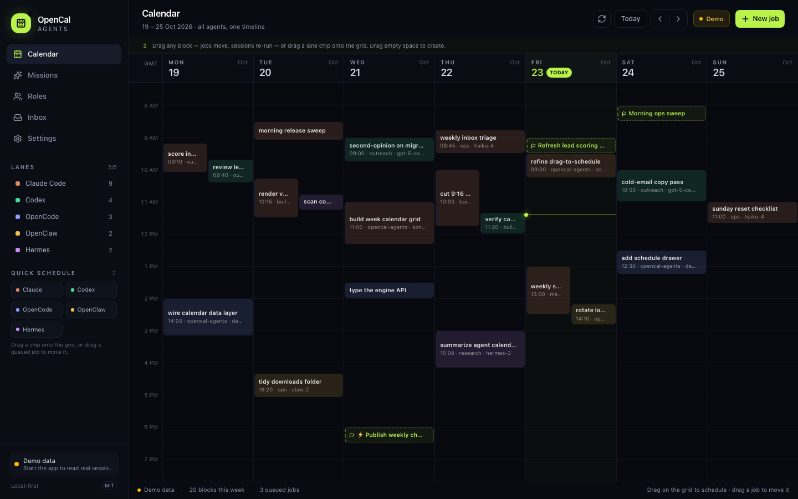
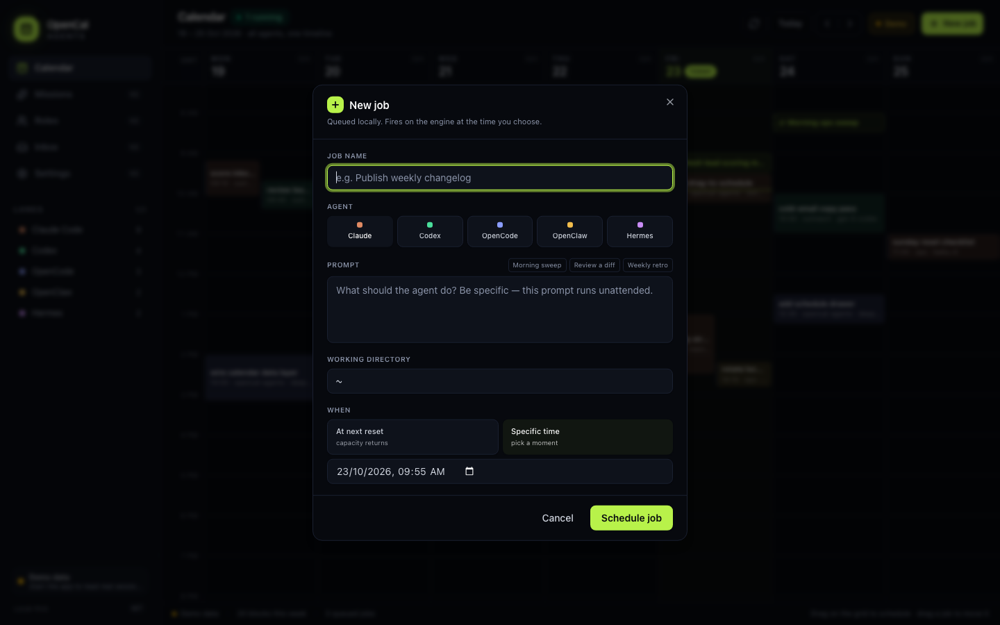
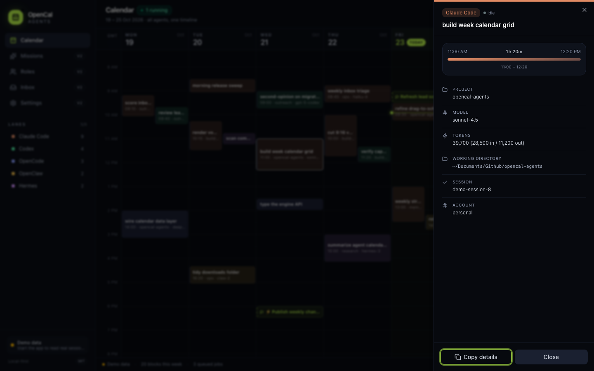

# OpenCal Agents

**A local-first calendar for your AI coding agents.** See every Claude Code,
Codex, OpenCode, OpenClaw and Hermes session on one timeline — then drag a job
onto the grid and let the scheduler fire it when capacity returns.

OpenCal Agents is an independent, MIT-licensed desktop app built on top of the
open-source [`agentcalendar`](https://www.npmjs.com/package/agentcalendar)
engine (MIT). It is not affiliated with, endorsed by, or a copy of AgentCal HQ.


---

## Screenshots

### One week, every agent

Five colour-coded lanes, overlap layout for double-booked agents, a live
"now" line, and queued jobs rendered as dashed blocks.



### Schedule a job

Pick an agent, write the prompt, choose a working directory and either
"at next reset" or a specific time.



### Receipts, not green ticks

Click any block for project, model, tokens, duration, working directory,
session id — and for jobs, the exact prompt and result.



---

## What works in v0.1

- **Week calendar** with a 24-hour grid, live "now" line, and overlap layout
  (double-booked agents render side by side).
- **Five lanes** — Claude Code, Codex, OpenCode, OpenClaw, Hermes — each with a
  colour and a filter.
- **Live engine mode**: reads real sessions from the local engine at
  `http://127.0.0.1:4747`.
- **Demo mode**: if the engine isn't running, the app fills the week with
  realistic sample data so the UI is still explorable.
- **Click any block** for a detail drawer: project, model, tokens, duration,
  working directory, session id.
- **Drag on the grid** to open a pre-filled job dialog.
- **Drag queued jobs** between days and times — snapped to 15 minutes, with a
  live drop ghost and auto-scroll near the edges.
- **Quick schedule tray** in the sidebar: drag an agent chip onto the grid to
  create a job at that slot.
- **Schedule a job**: name, agent, prompt, working directory, and either
  "at next reset" or a specific time.
- **Queued jobs** render as dashed blocks on the calendar.
- **Auto-refresh** every 12 seconds and on window focus.

## Roadmap

| Version | Scope |
| --- | --- |
| **v0.1** | Week calendar, lanes, receipts drawer, drag-to-schedule, Kanban drag-and-drop ✅ |
| **v0.2** | Missions, roles/playbooks, inbox + approvals |
| **v0.3** | Webhooks UI, iCal feed, Tailscale pairing |
| **v0.4** | Self-hosted run target (Docker) + browser terminal |
| **v0.5** | Windows/Linux packaging, auto-update |

## Stack

- **Tauri 2** (Rust shell, macOS/Windows/Linux)
- **React 19 + TypeScript + Vite**
- **Tailwind CSS v4** with **shadcn/ui** (Radix primitives)
- **`agentcalendar` engine** (MIT, vendored under `engine/`)

## Run it

Requirements: Node ≥ 22.13, pnpm, Rust 1.80+, Xcode Command Line Tools.

```bash
pnpm install
pnpm tauri dev
```

The Tauri shell starts the engine automatically (`engine/bin/agentcal.js`) and
the UI talks to it at `http://127.0.0.1:4747`.

### Browser-only development

```bash
pnpm dev
```

Without the Tauri shell the app runs in **Demo** mode. Open
`http://localhost:1420/?shot=dialog` or `?shot=detail` to jump straight to a
dialog/drawer state (used for the screenshots above).

### Environment overrides

- `OPENCAL_ENGINE` — absolute path to `agentcal.js` if you don't use the
  vendored copy.
- `OPENCAL_NODE` — absolute path to a Node ≥ 22.13 binary if the packaged app
  can't find one (the app resolves common Homebrew, `/usr/local` and nvm
  locations automatically).

## Known limitations in v0.1

- The desktop app expects **Node ≥ 22.13** on the machine; the engine uses
  Node's built-in SQLite. Bundling a Node runtime is planned for v0.2.
- **Live engine mode requires the desktop shell.** The engine only grants CORS
  to same-origin callers, so the app talks to it through Tauri's native HTTP
  client. Browser-only `pnpm dev` intentionally runs on demo data.
- Job blocks are fixed at 30 minutes on the grid; resize-to-duration is not
  persisted yet.

## Data & privacy

- Everything is local. The engine reads the JSONL transcripts your agent CLIs
  already write (`~/.claude/projects/**`, `~/.codex/sessions/**`, …).
- Store: `~/.agentcal/agentcal.db` (SQLite).
- No account, no cloud, no telemetry from this app.

## Project layout

```
opencal-agents/
├── engine/               # vendored MIT engine (collectors, scheduler, API)
├── src/                  # React UI
│   ├── components/       # Sidebar, Header, WeekCalendar, JobDrawer, NewJobDialog
│   ├── components/ui/    # shadcn/ui primitives (button, dialog, sheet, …)
│   └── lib/              # engine client, demo data, types, time helpers
├── src-tauri/            # Rust shell + commands (engine token / start)
├── docs/                 # screenshots used above
└── NOTICE                # upstream attribution
```

## License

MIT. See [LICENSE](./LICENSE) and [NOTICE](./NOTICE) for the upstream
`agentcalendar` attribution.
